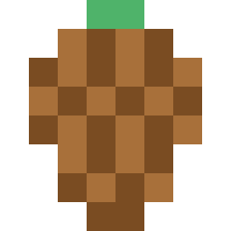
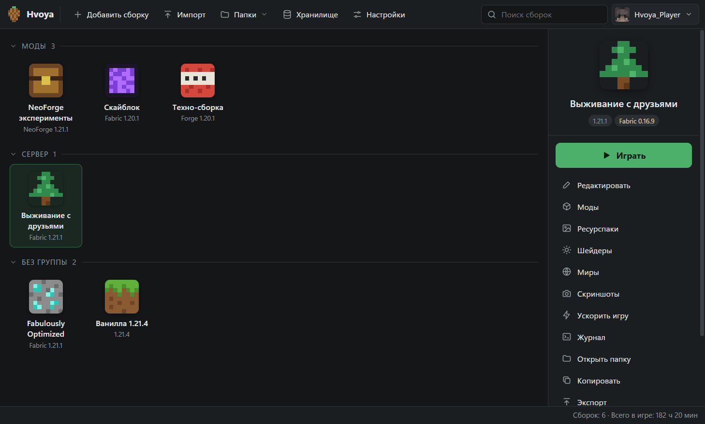
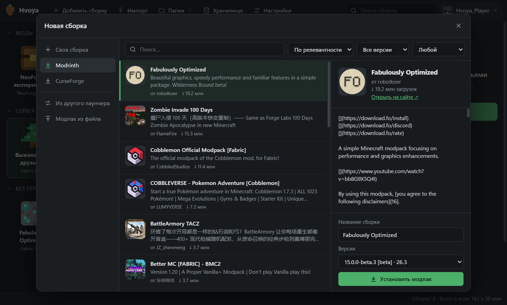
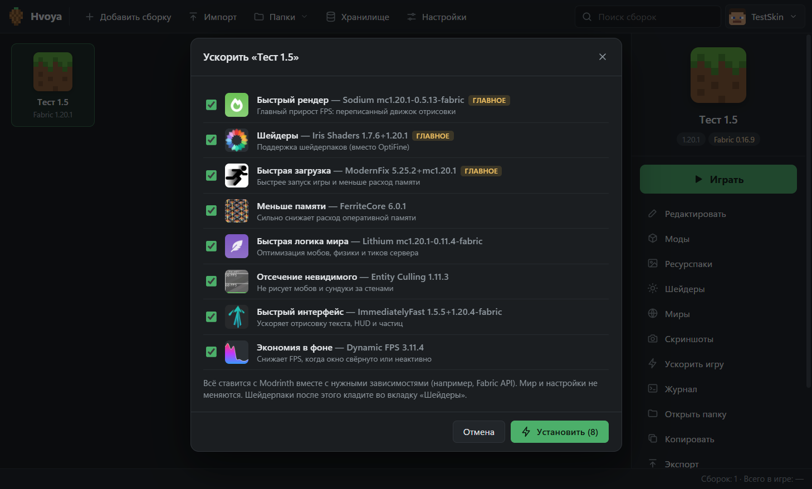
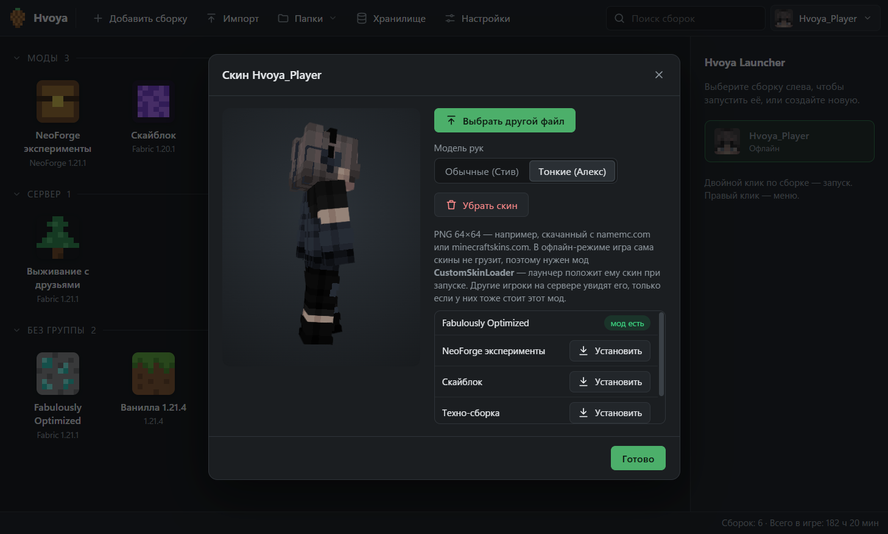
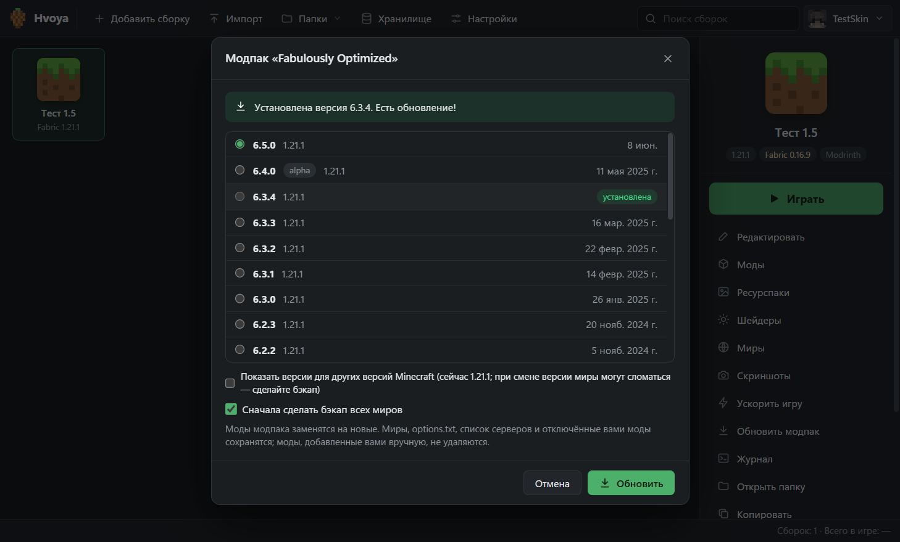
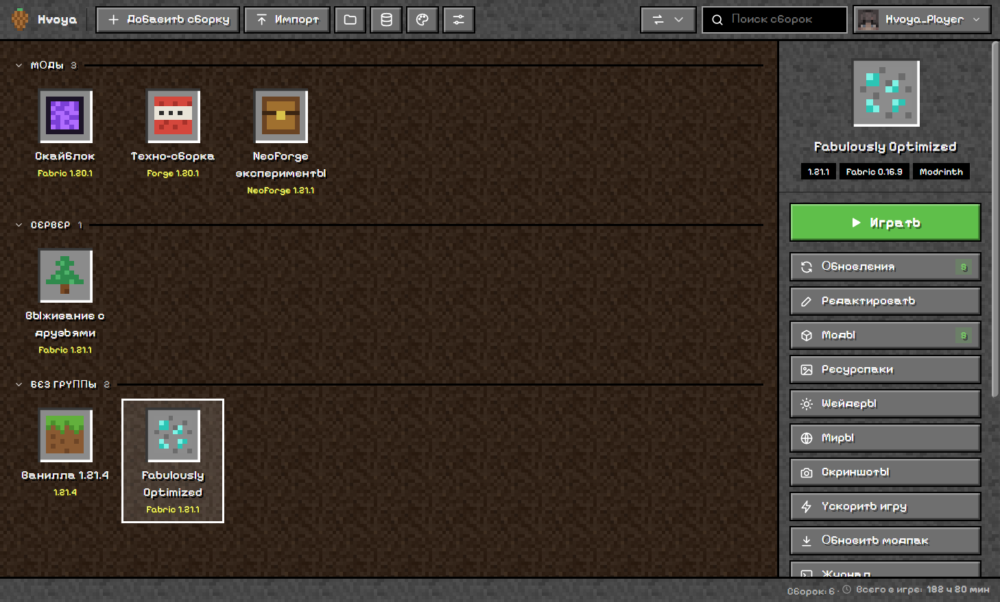
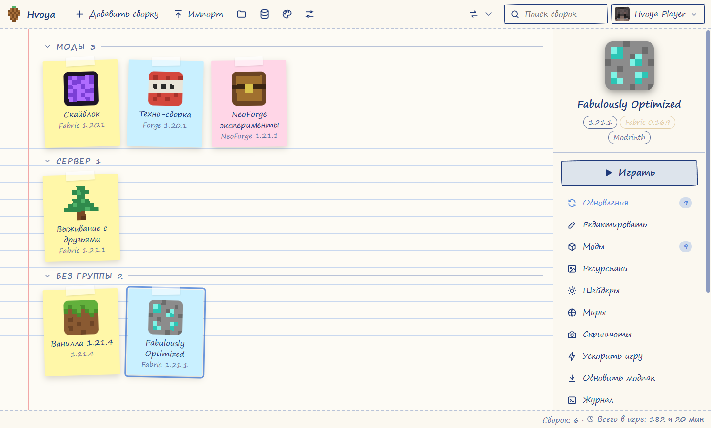

<p align="center">
  
</p>

<h1 align="center">Hvoya Launcher</h1>

<p align="center">
  Лёгкий лаунчер Minecraft с модами, модпаками и скинами. Играйте по нику или через Ely.by.
</p>

<p align="center">
  <a href="https://github.com/Ne-collab228/HvoyaLauncher/releases/latest"></a>
</p>

<p align="center">
  <a href="https://github.com/Ne-collab228/HvoyaLauncher/releases/latest"></a>
  <a href="https://github.com/Ne-collab228/HvoyaLauncher/releases"></a>
  <a href="LICENSE"></a>
</p>

| | |
| :---: | :---: |
| 🆓 **Бесплатно и без рекламы**<br>Никаких сторонних программ в установщике | 🔑 **Пароль не хранится**<br>Для Ely.by сохраняется только токен входа |
| ☕ **Java не нужна**<br>Лаунчер сам скачивает нужную версию | 📖 **Открытый код**<br>Любую строку можно проверить прямо здесь |

<p align="center">
  
</p>

| Каталог модпаков | Ускорить игру |
| :---: | :---: |
|  |  |
| **Скин в 3D** | **Обновление модпака** |
|  |  |
| **Тема «Пиксель»** | **Тема «Блокнот»** |
|  |  |

## Возможности

- **18 тем оформления:** 12 цветовых и 6 особых, которые полностью меняют вид: Пиксель, Терминал, Ретро 98, Стекло, Неон, Блокнот. Свой акцентный цвет, фон (пиксельные пейзажи, своя картинка или скриншот из игры), сборки плитками, списком или карточками.
- **Поделиться сборкой кодом:** друг вставляет короткий код `HVOYA1:…`, и лаунчер ставит ту же версию, загрузчик и моды.
- **Любая версия и загрузчик:** Vanilla, Fabric, Forge, NeoForge, Quilt.
- **Моды, ресурспаки и шейдеры** с Modrinth и CurseForge. Зависимости ставятся сами. Обновления проверяются в фоне, счётчик виден прямо у сборки.
- **Модпаки:** установка из каталога, импорт `.mrpack` и CurseForge `.zip`. Обновление до новой версии сохраняет миры, настройки и отключённые моды.
- **«Ускорить игру»:** Sodium, Iris и ModernFix (на Forge — Embeddium и Oculus) плюс FerriteCore, Lithium и другие в один клик.
- **Аккаунты:** офлайн по нику или Ely.by со скинами и 2FA. Скин виден в 3D. Офлайн-аккаунту можно выбрать свой скин (в игре через CustomSkinLoader).
- **Память:** предупреждение, если выделено слишком много для компьютера или слишком мало для модов.
- **Миры и бэкапы:** zip-копии миров, восстановление, перенос мира в другую сборку.
- **Анализ вылетов:** лаунчер объясняет на русском, какой мод сломал игру и что сделать.
- **Импорт из других лаунчеров:** Prism, MultiMC, PineconeMC, CurseForge, Modrinth App, ATLauncher, TLauncher.
- **Экспорт сборки** в `.mrpack` или `.zip`, чтобы поделиться с друзьями.
- **Время в игре:** живой счётчик, статистика по дням и по сборкам.
- **Ещё:** скриншоты, статус в Discord, журнал игры в реальном времени, группы, сортировка и 49 иконок для сборок.

## Установка

<details>
<summary><b>Windows</b>: установщик <code>.exe</code></summary>

1. Скачайте `HvoyaLauncher-Setup-X.Y.exe` со страницы [релизов](https://github.com/Ne-collab228/HvoyaLauncher/releases/latest) и запустите.
2. Если появится синее окно «Система Windows защитила ваш компьютер», нажмите **«Подробнее»**, затем **«Выполнить в любом случае»**. Установщик не подписан платным сертификатом, поэтому Windows его не знает.

По умолчанию лаунчер ставится в `C:\HvoyaLauncher`. Удаление: «Параметры» → «Приложения».

Лаунчер обновляется сам.
</details>

<details>
<summary><b>Портативная версия</b>: без установки</summary>

Скачайте `HvoyaLauncher.exe` из [релизов](https://github.com/Ne-collab228/HvoyaLauncher/releases/latest) и положите в любую папку. Всё хранится рядом, в папке `data\`. Удобно носить на флешке.
</details>

## Для разработчиков

Python 3.13 + [pywebview](https://pywebview.flowrl.com/) (WebView2), интерфейс на чистом HTML/CSS/JS. Установка игры: [minecraft-launcher-lib](https://codeberg.org/JakobDev/minecraft-launcher-lib), 3D-скины: [skinview3d](https://github.com/bs-community/skinview3d). Лицензия: [MIT](LICENSE).

- `run.bat` — запуск из исходников.
- `build.bat` — сборка exe и установщика в `dist\` (нужны PyInstaller и Inno Setup 6).
- Устройство проекта и известные грабли описаны в [CLAUDE.md](CLAUDE.md).

<details>
<summary><b>Где что лежит</b></summary>

```
data\
  minecraft\          общие файлы: версии, библиотеки, ассеты, Java от Mojang
  instances\<сборка>\
     instance.json    настройки сборки
     .minecraft\      своя игровая папка: mods, saves, config, resourcepacks…
  backups\            бэкапы миров (не пропадают при удалении сборки)
  skins\              свои скины офлайн-аккаунтов
  accounts.json       аккаунты (для Ely.by только токен)
  settings.json       настройки лаунчера
```
</details>

<sub>Hvoya Launcher не связан с Mojang AB или Microsoft. Minecraft — торговая марка Mojang AB.</sub>
